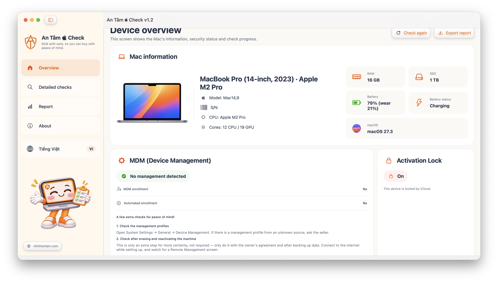
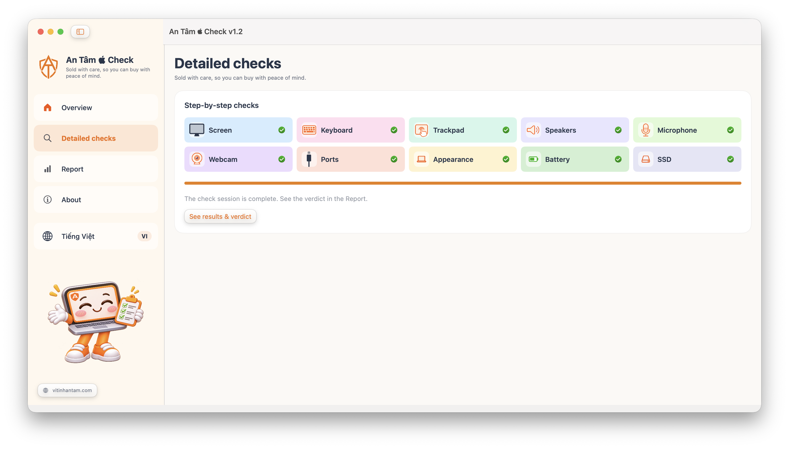
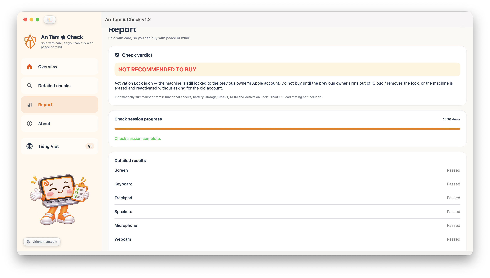
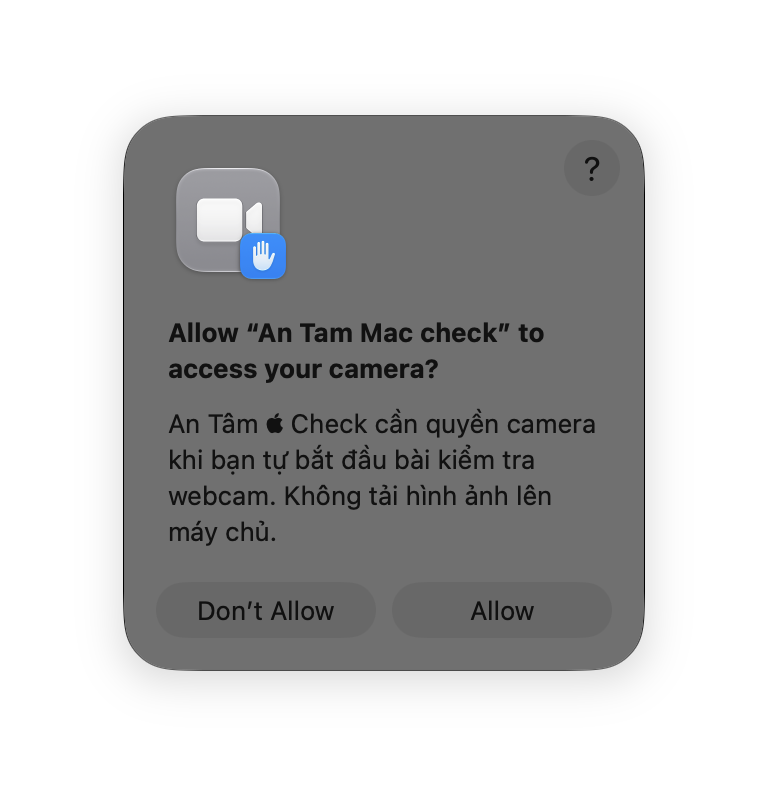
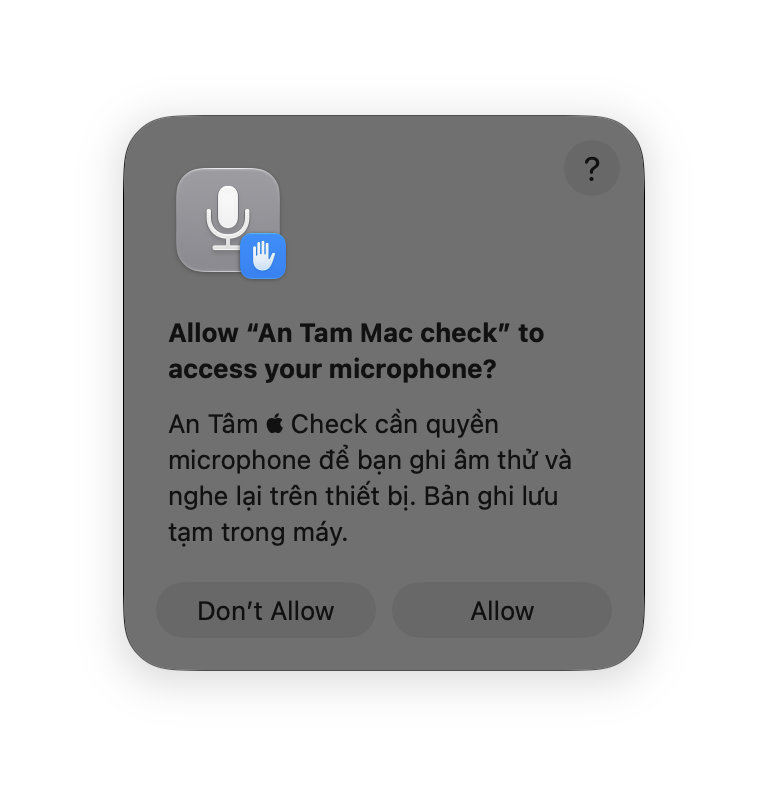

🌐 **Language / Ngôn ngữ:** [Tiếng Việt](README.md) | English

# An Tâm  Check

  

<strong>A used-Mac inspection app from <a href="https://vitinhantam.com">Vi Tính An Tâm</a>.</strong>

> **Sold with care, so you can buy with peace of mind.**

Open the app and it reads the machine's specs, then walks you through checking each part: screen, keyboard, trackpad, speakers, microphone, webcam, ports, appearance, battery, storage, MDM and Activation Lock. When everything is done, the Report page sums it up: whether the machine is good, what still needs attention, and a closing note from An Tâm.

The app is written in SwiftUI and runs on **macOS 13 or later**. The current version is **1.2**.

## Download

- All releases: https://github.com/YHresearcher/AntamMaccheck/releases
- Latest build (no GitHub login needed): https://github.com/YHresearcher/AntamMaccheck/releases/latest/download/AnTam-Mac-check-macOS.zip

Download the zip, unzip it once to get `An Tam Mac check.app`. Open it and use it right away — no need to drag it into your Applications folder.

### First launch

This build is not Apple-signed and not notarized (only ad-hoc signed), so macOS may block it when you first open it:

1. Right-click the app → **Open** → click **Open**.
2. If it is still blocked: **System Settings → Privacy & Security → Open Anyway**.
3. Do not turn off Gatekeeper system-wide, and do not run as root.

## Real screenshots

Real screenshots of the app running on a MacBook Pro (14-inch, 2023) M2 Pro:

### Overview

  

### Step-by-step checks

  

### Report

  

## Privacy

The app asks for exactly **2 permissions**, and only when you start that test yourself:

| Permission | Asked when | What it is used for |
| --- | --- | --- |
| **Camera** | The **Webcam** test | Shows a live preview so you can judge it yourself. Nothing is recorded, saved or sent anywhere. |
| **Microphone** | The **Microphone** test | Records a short sample and plays it back on the device so you can judge it yourself. Only stored temporarily on the machine. |

The app does **not** request Screen Recording, Input Monitoring, Accessibility or Location. The permission dialog language follows your macOS system language, not the in-app language button. If you clicked "Don't Allow", turn it back on in **System Settings → Privacy & Security → Camera / Microphone**.

  
  

## How to use

The sidebar has 3 pages: **Overview** (device info, MDM + Activation Lock, "Passed x/10" summary), **Step-by-step checks** (grid of 10 checks + a wizard that goes through them one by one), **Report** (verdict, results, a note from An Tâm, JSON export). The **About** button opens the shop's introduction; the **EN/VI** button (globe icon) switches the whole interface, and your choice is remembered.

### The 10 checks

- **Screen:** 12 fullscreen colors (← / → to change, Esc to exit); you must view all 12 to confirm.
- **Keyboard:** type a real key, the virtual key lights up green; at least 10 keys needed.
- **Trackpad:** move a finger, no need to click; at least 10 movements needed.
- **Speakers:** 8-second stereo tune (4 seconds left, 4 seconds right); listen for buzz, distortion or imbalance.
- **Microphone:** record, then play back and judge clarity yourself.
- **Webcam:** live preview; judge clarity and noise yourself.
- **Ports:** list of USB/Thunderbolt devices the system sees; plug a real device into each port to be sure.
- **Appearance:** check by eye (case, hinges, dents, swollen battery...).
- **Battery:** health %, cycle count; below 80% means degraded.
- **SSD:** each drive + SMART; SMART unreadable does not mean the drive is broken or good.

**Battery, MDM, Activation Lock:** battery below 80% or over 1000 cycles — factor in replacement cost. MDM: both items No means about 80% likely no MDM (not 100%). Activation Lock on means the machine is still locked to the previous owner's Apple account — do not buy until it is removed.

## Verdict (Report page)

| Verdict | When |
| --- | --- |
| **NOT RECOMMENDED TO BUY** | MDM/ADE detected, or Activation Lock is on. |
| **FAULTS FOUND — NEEDS REVIEW** | A check failed, battery below 80%, or SMART reports a fault. |
| **NOT ENOUGH DATA** | A check is still untried. |
| **POINTS TO NOTE** | Everything passed, but battery 80–89%, over 1000 cycles, SMART unreadable... |
| **MACHINE LOOKS GOOD** | 10/10 passed. |

"A note from An Tâm" at the end of the Report page: one couplet per scenario (good machine, usable machine, needs negotiating, many faults, do not buy).

## Limits to know

- The checks are observed and confirmed by the technician; the app does not diagnose for you. No CPU/GPU load test yet.
- The verdict is not a certification that a Mac is safe to buy.
- The app sends no data anywhere.

## Build from source

Requires macOS 13 or later with a Swift toolchain: `swift run AnTamMacCheck`. Every successful build on `main` creates a new Release with `AnTam-Mac-check-macOS.zip`.

## Shop info

- **Vi Tính An Tâm** — https://vitinhantam.com
- Branch 1: 52 Nguyễn Cửu Vân, Long An ward, Tây Ninh province
- Branch 2: 218/3 Street 11, Thủ Đức ward, Ho Chi Minh City
- 6-month warranty on the whole machine.

## License

This app is licensed under the **PolyForm Noncommercial License 1.0.0** (see `LICENSE`): use, modify and share for **noncommercial** purposes only; commercial use requires permission from the shop first. The battery-reading method references MacMonitor (MIT) — see `THIRD_PARTY_NOTICES.md`.
